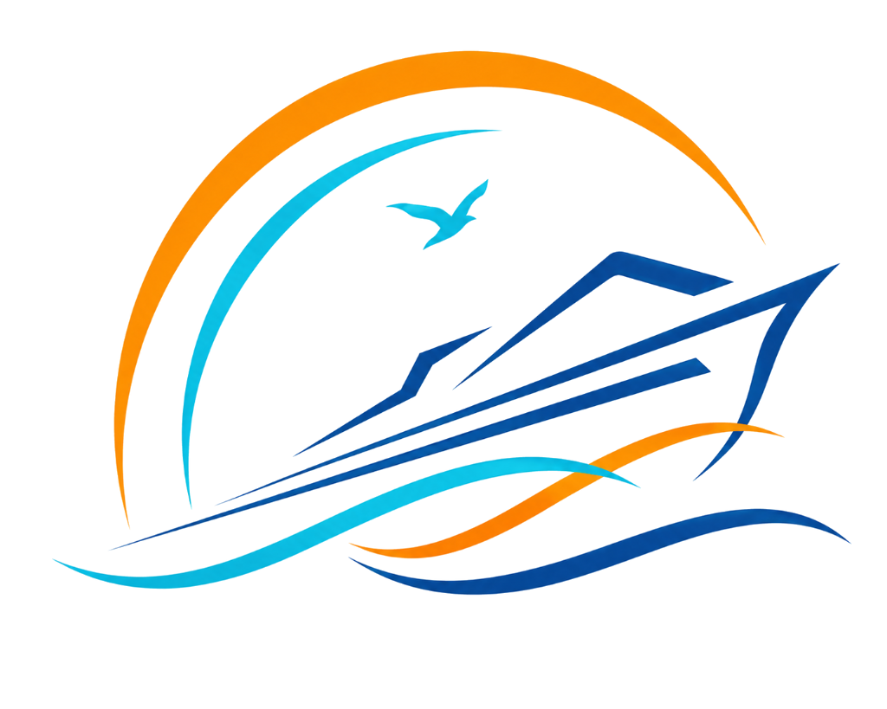

# Jayanth Marine Services ⚓

Official web portal and under-construction experience for **Jayanth Marine Services** — specialists in comprehensive vessel management, marine engineering & ship repair, port agency logistics, offshore support, and 24/7 marine salvage.

## 🚢 Features

- **Dynamic Floating Vessel Engine**: Multi-layer procedural ocean wave simulation with real-time buoyancy, heave, and pitch calculations.
- **Vessel Geometry**: Modeled directly after the Jayanth Marine Services emblem with animated rotating radar, blinking navigation lights, and dynamic wake/splash physics.
- **Interactive Maritime Controls**:
  - 🎺 **Maritime Foghorn**: Synthesized live via Web Audio API.
  - 🌊 **Sea State Controller**: Calm Harbor, Ocean Swell, and High Seas.
  - ⚡ **Full Ahead Boost**: Sprint throttle up to 28.5 Knots.
  - 🌅 **Atmospheric Switcher**: Sunset Horizon (signature logo palette), Midnight Radar, and Harbor Daylight.
  - 🔊 **Ambient Sea Waves**: Real-time synthesized ocean surf soundscape.
- **Under Construction Suite**:
  - Maiden launch countdown clock (Days, Hours, Minutes, Seconds).
  - Vessel commissioning progress meter (87% ready).
  - VIP priority dispatch notification form.
  - 6 interactive 3D tilt capability cards.
  - Direct dispatch duty desk and instant inquiry ticket modal.

## 🚀 Deployment (Vercel)

This is a pure static web application with zero external dependencies, making it blazing fast and instantly deployable on **Vercel**:

1. Push to GitHub (`main` branch).
2. Connect the repository in Vercel.
3. Framework Preset: **Other** / **Static Site**.
4. Root Directory: `./`
5. Click **Deploy**.

## 🛠️ Tech Stack

- **HTML5**: Semantic, accessible markup.
- **CSS3**: Custom design tokens, glassmorphism, responsive flex/grid, micro-animations.
- **JavaScript (Vanilla)**: Canvas wave physics, buoyancy calculus, particle systems, and Web Audio API synthesis.

---
© 2026 Jayanth Marine Services. All Rights Reserved.
